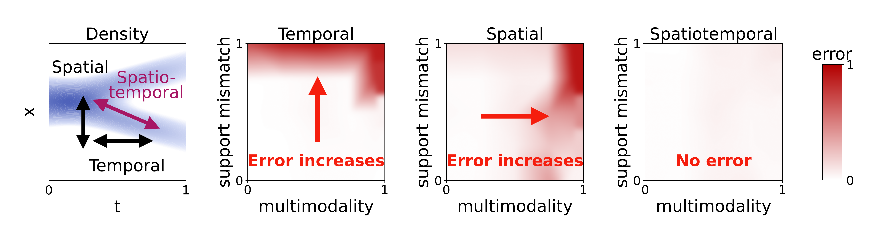

# stNCE

Official implementation of the NeurIPS 2026 paper, [Learning Energy-Based Models from Stochastic Interpolants using Spatiotemporal Differences](https://arxiv.org/abs/2605.26850).



For further instructions see the README.md inside each folder.

## stNCE

Experiments apart from failure modes (teaser image) and molecules.

## teaser-stNCE

Failure modes (teaser image) experiment.

## ScoreMD-stNCE

Molecule experiments.

## Citation

```
@inproceedings{yu2026stnce,
	title = {Learning {Energy}-{Based} {Models} from {Stochastic} {Interpolants} using {Spatiotemporal} {Differences}},
	booktitle = {The {Fortieth} {Annual} {Conference} on {Neural} {Information} {Processing} {Systems}},
	author = {Yu, Hanlin and OuYang, RuiKang and Kaushik, Partha and Klami, Arto and Gutmann, Michael U. and Chehab, Omar},
	year = {2026},
}
```
